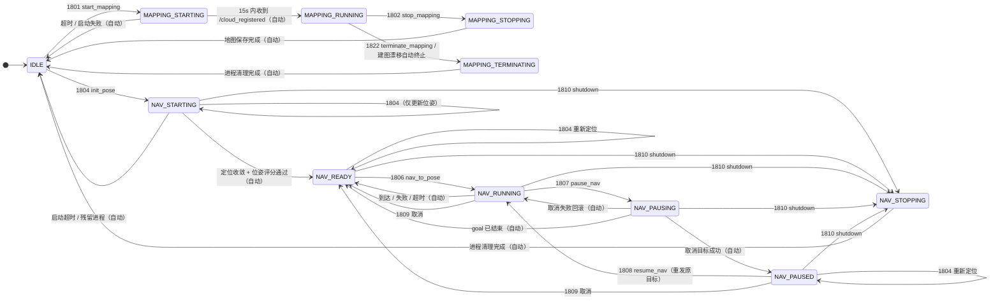
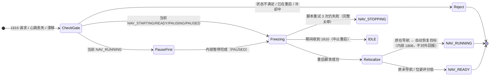

# 导航 SDK 状态机（11 状态 · 全迁移）

> **依据：** SDK 实际运行行为与 `/slam/status` 消息整理。
> **配套文档：** [SDK 接口文档](./SDK接口文档.md)（字段、报文、错误码）、[SDK 调用示例](./SDK调用示例.md)、[SDK 全流程操作手册](./SDK全流程操作手册.md)。
> **English:** [SDK State Machine](./en/SDK_STATE_MACHINE.md)
> **观测方式：** `/slam/_state`（`std_msgs/String`，10 Hz 广播当前状态）；或轮询 1815 `/slam/get_state`。
> **最后修改时间：** 2026-11-16

---

## 1. 状态一览

| 状态 | 含义 | `scene_id` 来源 | 说明 |
|------|------|-----------------|------|
| `IDLE` | 空闲 | `null` | 唯一可发起建图（1801）的状态 |
| `MAPPING_STARTING` | 建图启动中 | `request.scene_id` | 等待 `/cloud_registered` 出现（15 s） |
| `MAPPING_RUNNING` | 建图中 | `request.scene_id` | 此期间拒绝一切定位/导航请求 |
| `MAPPING_STOPPING` | 结束建图中 | `request.scene_id` | 保存地图 → 关闭进程 |
| `MAPPING_TERMINATING` | 强制终止中 | `request.scene_id` | 直接杀进程，**不保存地图** |
| `NAV_STARTING` | 定位/导航启动中 | 当前导航 `scene_id` | 拉起定位与导航栈，等待就绪（`nav_wait_time`=90 s） |
| `NAV_READY` | 已定位、无目标 | 当前导航 `scene_id` | 可下发目标（1806）、可重定位（1804） |
| `NAV_RUNNING` | 导航中 | 当前导航 `scene_id` | 不可直接改目标，需先取消（1809） |
| `NAV_PAUSING` | 暂停中（取消已发出，等结果） | 当前导航 `scene_id` | 过渡态，通常几十 ms~2 s |
| `NAV_PAUSED` | 已暂停 | 当前导航 `scene_id` | 保留原目标，可 1808 恢复 |
| `NAV_STOPPING` | 关停中 | 当前导航 `scene_id` | 清理定位/导航/雷达进程 |

> 另有**内部标志 `freezing`（不是状态值）**：里程计重启期间置位，此时只放行 1804（重定位）与 1810（关停），见第 4 节。

---

## 2. 主状态机



> 建图与导航互斥：`MAPPING_*` 期间只接受 1802 / 1822 / 1815，`NAV_*` 期间只接受 1804~1816。

---

## 3. 迁移明细

### 3.1 建图分支

| 起点 | 触发 | 终点 | 条件 / 失败返回 |
|------|------|------|-----------------|
| `IDLE` | 1801 | `MAPPING_STARTING` | 非 `IDLE` 返回 `Another task already running or in stopping` |
| `MAPPING_STARTING` | 自动 | `MAPPING_RUNNING` | `/cloud_registered` 在 15 s 内出现 → 1801 `success=1` |
| `MAPPING_STARTING` | 自动 | `IDLE` | 15 s 超时 → 清理进程 → 1801 `success=2 "mapping start failed"` |
| `MAPPING_RUNNING` | 1802 | `MAPPING_STOPPING` | 非 `MAPPING_RUNNING` 返回 `Mapping not running` |
| `MAPPING_STOPPING` | 自动 | `IDLE` | 三个地图文件 `map.pcd/pgm/yaml` 拷贝完成；缺文件/拷贝异常仍回 `IDLE`，但 1802 `success=2` |
| `MAPPING_RUNNING` | 1822 | `MAPPING_TERMINATING` | 非 `MAPPING_RUNNING` 返回 `Mapping not running`；**不保存地图** |
| `MAPPING_RUNNING` | 自动 | `MAPPING_TERMINATING` | 建图漂移：`map_drift_confirm_n`（默认 3）帧连续超速（`map_drift_speed_thr`=5 m/s）→ 内部以 `request_id = drift_caused_terminate` 触发 1822（不回外部 `request_id`） |
| `MAPPING_TERMINATING` | 自动 | `IDLE` | 进程组 SIGKILL 完成 → 1822 `success=1` |

### 3.2 定位 / 导航分支

| 起点 | 触发 | 终点 | 条件 / 失败返回 |
|------|------|------|-----------------|
| `IDLE` | 1804 | `NAV_STARTING` | 校验 `scene_id` 一致、地图文件齐全，否则 1804 `success=2` 且状态不变 |
| `NAV_STARTING` | 自动 | `NAV_READY` | 定位误差收敛到 `pose_err_thr`（0.2 m）内 + 位姿评分通过，限时 `nav_wait_time`（90 s）→ 1804 `success=1 "Ready for navigation"` |
| `NAV_STARTING` | 自动 | `IDLE` | 导航未就绪（1804 `success=2` 并关停导航栈）：`Timeout to start navigation, please restart`（定位误差未收敛）/ `Low pose score, please relocalize`（位姿评分不达标）/ `Pose score service unavailable, please restart`（评分服务不可用）；或有残留导航进程 |
| `NAV_STARTING` | 1810 | `NAV_STOPPING` | 并发关停时 1804 返回 `Nav was aborted before start` |
| `NAV_STARTING` | 1804 | `NAV_STARTING` | 仅更新初始位姿，不重启导航栈 |
| `NAV_READY` | 1806 | `NAV_RUNNING` | 定位误差 > `nav_reject_err_thr`（默认 0.4 m）拒绝：`Localization error too high`；`NAV_RUNNING` / `NAV_STARTING` / `IDLE` 下同样拒绝（需先 1809 取消或等待就绪） |
| `NAV_READY` | 1804 | `NAV_READY` | 重新定位（自环），不改变状态 |
| `NAV_RUNNING` | 自动 | `NAV_READY` | 到达目标（1806 `success=1`）或 aborted（1806 `success=2`） |
| `NAV_RUNNING` | 1809 | `NAV_READY` | `NAV_RUNNING`/`NAV_PAUSING` 才可取消，否则 `Navigation not running` |
| `NAV_RUNNING` | 自动 | `NAV_READY` | 导航超时（`max_nav_time`=240 s）→ 内部以 `timeout_caused_cancel` 触发 1809；goal 状态置 CANCELED，而不是进入暂停 |
| `NAV_RUNNING` | 1807 | `NAV_PAUSING` | 非 `NAV_RUNNING` 返回 `Failed to pause because navigation not running` |
| `NAV_PAUSING` | 自动 | `NAV_PAUSED` | 取消目标成功 → 保留原目标与 `nav_request_id`，1807 `success=1` |
| `NAV_PAUSING` | 自动 | `NAV_RUNNING` | 取消目标失败 → 回滚，导航继续，1807 `success=2` |
| `NAV_PAUSING` | 自动 | `NAV_READY` | 取消时 goal 已自然结束 → 按正常结束处理 |
| `NAV_PAUSED` | 1808 | `NAV_RUNNING` | 非 `NAV_PAUSED` 返回 `Goal not paused, failed to resume`；无保存目标返回 `Goal not received` |
| `NAV_PAUSED` | 1806（原 `request_id`） | `NAV_RUNNING` | 仅内部恢复（1808 重发原目标，`request_id` 与原导航一致）可进；外部新目标返回 `Navigation paused, please resume before request` |
| `NAV_PAUSED` | 1809 | `NAV_READY` | 额外回报一条 1806 `success=2 "Navigation cancelled while paused"` |
| `NAV_PAUSED` | 1804 | `NAV_PAUSED` | 重新定位（自环），保留暂停态与原目标 |
| `NAV_STARTING/READY/RUNNING/PAUSING/PAUSED` | 1810 | `NAV_STOPPING` | 其它状态返回 `Navigation not ready`；成功后 `scene_id` 清空、`NAV_*` 期间的地图绑定解除 |
| `NAV_STOPPING` | 自动 | `IDLE` | 关停完成（残留进程会导致 1810 `success=2`，但状态仍回 `IDLE`） |

### 3.3 查询类（不改变状态）

| 编码 | 允许状态 | 备注 |
|------|----------|------|
| 1805 `/slam/get_global_pose` | `NAV_READY` / `NAV_RUNNING` / `NAV_PAUSED` / `NAV_STOPPING` | 其它状态返回 `Navigation invalid, no global pose prepared to response` |
| 1814 `/slam/get_nav_state` | 仅 `NAV_RUNNING` | 其它状态返回 `Robot not in navigation state` |
| 1815 `/slam/get_state` | 任意 | 返回状态字符串；`MAPPING_*` 返回建图 `scene_id` |

---

## 4. 里程计重启子流程（1816，含 `freezing` 闸门）

1816 不是独立状态，而是叠加在导航状态上的**互斥子流程**：



| 阶段 | 行为 |
|------|------|
| 入口校验 | 仅 `NAV_STARTING`/`NAV_READY`/`NAV_RUNNING`/`NAV_PAUSING`/`NAV_PAUSED`；否则 `Odom restart ignored: abnormal state` |
| 重入/冷却 | 已在重启 `already restarting`；自动触发间隔 < `restart_cooldown`（10 s）→ `cooldown`（外部显式调用不受冷却限制） |
| 暂停 | 仅当前 `NAV_RUNNING` 需要，复用 1807 流程，5 s 内未到 `PAUSED` 则强制置 `NAV_PAUSED` |
| `freezing` | 置位期间**只放行 1804 与 1810**，其它指令返回 `Odom recovering, only relocalize/shutdown allowed` |
| 重定位 | 复用 1804：以重启前位姿 P 重新锚定；`relocalize=true` 时再以 P 为中心做限定范围 BBS 全局重定位（`odom_restart_search_range`=3 m） |
| 成功 | 原在导航 → 自动恢复原目标回 `NAV_RUNNING`；否则回 `NAV_READY`；1816 `success=1 "Odom restarted"` |
| 失败 | 位姿评分低 → `NAV_READY`（同时原 1806 回报失败）；脚本重试耗尽 → 内部 1810 完整关停 → `NAV_STOPPING` → `IDLE` |

---

## 5. 自动保护机制（无需外部请求）

| 机制 | 触发条件 | 动作 | 状态影响 |
|------|----------|------|----------|
| 里程计心跳丢失 | `NAV_STARTING` 超过 30 s / 其余导航态超过 1 s 无里程计 | 自动 1816（`request_id = odom_lost_caused_restart`） | 见第 4 节 |
| 里程计漂移 | `odom_drift_confirm_n`（5）帧连续速度 > `odom_drift_thr`（5 m/s） | 自动 1816 | 见第 4 节 |
| 导航超时 | `NAV_RUNNING` 超过 `max_nav_time`（240 s） | 自动 1809 | `NAV_RUNNING → NAV_READY` |
| 建图漂移 | `MAPPING_RUNNING` 连续 3 帧速度 > 5 m/s | 自动 1822 | `MAPPING_RUNNING → MAPPING_TERMINATING → IDLE` |
| 重启后自愈失败 | 脚本重试 3 次仍失败 | 内部 1810 | `NAV_STOPPING → IDLE` |

---

## 6. 附录：与旧版《SDK 状态》图的差异（仅仓库维护参考，用户可跳过）

旧图（`SDK状态.pdf`，已不再随文档发布）主体结构正确，但存在以下问题：

| # | 问题 | 正确画法 |
|---|------|----------|
| 1 | **缺少 `MAPPING_TERMINATING` 状态** | `MAPPING_RUNNING → MAPPING_TERMINATING`（1822 / 漂移自动终止）`→ IDLE` |
| 2 | **缺少 `NAV_PAUSING` 状态**，`1807` 直接到 `NAV_PAUSED` | `NAV_RUNNING → NAV_PAUSING`（1807）`→ NAV_PAUSED`（取消成功）/`→ NAV_RUNNING`（取消失败回滚） |
| 3 | `1808 nav_resume` 画成 `NAV_PAUSED → NAV_READY` | `1808 → NAV_RUNNING`（重发原目标）；`1806` 在 `NAV_PAUSED` 下也可直接进 `NAV_RUNNING` |
| 4 | `1809 nav_cancel` 从建图区指向 `NAV_READY` | `1809` 只在 `NAV_RUNNING`/`NAV_PAUSING`/`NAV_PAUSED` 有效，均回 `NAV_READY`；`MAPPING_*` 下会被拒绝 |
| 5 | 缺少 `NAV_RUNNING → NAV_READY` 的**正常结束**边 | 到达/失败/超时自动取消都会回 `NAV_READY` |
| 6 | 缺少 `NAV_PAUSED → NAV_READY`（1809 取消） | 暂停态取消回 `NAV_READY`，并额外回报一条 1806 失败 |
| 7 | 缺少失败回落边 | `MAPPING_STARTING → IDLE`（15 s 超时）、`NAV_STARTING → IDLE`（启动失败/超时） |
| 8 | 缺少 `1804` 自环 | `NAV_STARTING`/`NAV_READY`/`NAV_PAUSED` 下 1804 只更新位姿，状态不变 |
| 9 | 缺少 `1816` / `freezing` 子流程 | 单独一张子图（第 4 节），否则用户无法理解"为什么重启里程计时所有指令都被拒" |
| 10 | 缺少自动保护机制 | 心跳丢失、漂移、导航超时、建图漂移均会自动改变状态（第 5 节） |
| 11 | `1810` 只画了部分来源 | 合法来源为 `NAV_STARTING`/`READY`/`RUNNING`/`PAUSING`/`PAUSED` 五个 |

---

## 7. 典型调用序列

```
建图：  IDLE →1801→ MAPPING_STARTING →(自动)→ MAPPING_RUNNING →1802→ MAPPING_STOPPING →(自动)→ IDLE
定位：  IDLE →1804→ NAV_STARTING →(自动)→ NAV_READY
导航：  NAV_READY →1806→ NAV_RUNNING →(到达)→ NAV_READY
暂停：  NAV_RUNNING →1807→ NAV_PAUSING →(自动)→ NAV_PAUSED →1808→ NAV_RUNNING
取消：  NAV_RUNNING →1809→ NAV_READY
关停：  NAV_* →1810→ NAV_STOPPING →(自动)→ IDLE
```

---

## 8. 观测与日志

| 用途 | 命令/路径 |
|------|-----------|
| 当前状态 | `slam_state` / `ros2 topic echo /slam/_state --once` |
| 持续看状态 | `ros2 topic echo /slam/_state` |
| 接口响应 | `slam_status` / `ros2 topic echo /slam/status --full-length` |
| 请求+响应日志 | `logs/slam_sdk.log`（`grep '\[API'`） |
| 导航失败现场 | `logs/nav_fail/<时间戳>/annotated.png`、`meta.json` |
| 导航/定位日志 | `logs/nav2.log`、`logs/dll.log`、`logs/livox.log` |

> 现场操作、CPU 监控、Foxglove 调试和完整排查流程见 [SDK 全流程操作手册](./SDK全流程操作手册.md)。
