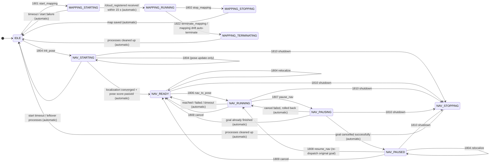
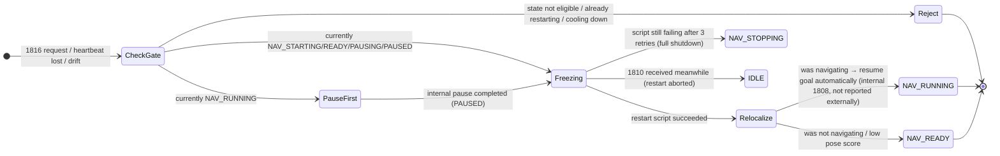

# Navigation SDK State Machine (11 states · all transitions)

> **Note:** This is the English version of [SDK状态机.md](../SDK状态机.md).
> **Basis:** the SDK's actual runtime behavior and `/slam/status` messages.
> **Companion documents:** [SDK Interface Documentation](./SDK_INTERFACE.md) (fields, messages, error codes), [SDK Usage Examples](./SDK_EXAMPLES.md), [SDK Full Workflow Guide](./SDK_FULL_WORKFLOW_GUIDE.md).
> **How to observe:** `/slam/_state` (`std_msgs/String`, broadcasts the current state at 10 Hz); or poll 1815 `/slam/get_state`.
> **Last updated:** 2026-11-16

---

## 1. State Overview

| State | Meaning | `scene_id` source | Notes |
|------|------|-----------------|------|
| `IDLE` | Idle | `null` | The only state in which mapping (1801) can be started |
| `MAPPING_STARTING` | Mapping is starting | `request.scene_id` | Waiting for `/cloud_registered` to appear (15 s) |
| `MAPPING_RUNNING` | Mapping in progress | `request.scene_id` | All localization/navigation requests are rejected during this period |
| `MAPPING_STOPPING` | Stopping mapping | `request.scene_id` | Save the map → shut down the processes |
| `MAPPING_TERMINATING` | Force-terminating | `request.scene_id` | Kill the processes directly, **the map is not saved** |
| `NAV_STARTING` | Localization/navigation is starting | Current navigation `scene_id` | Bring up localization and the navigation stack, wait until ready (`nav_wait_time`=90 s) |
| `NAV_READY` | Localized, no goal | Current navigation `scene_id` | A goal (1806) can be dispatched; relocalization (1804) is possible |
| `NAV_RUNNING` | Navigating | Current navigation `scene_id` | The goal cannot be changed directly; cancel first (1809) |
| `NAV_PAUSING` | Pausing (cancel sent, awaiting result) | Current navigation `scene_id` | Transitional state, typically tens of ms to 2 s |
| `NAV_PAUSED` | Paused | Current navigation `scene_id` | The original goal is retained; can be resumed with 1808 |
| `NAV_STOPPING` | Shutting down | Current navigation `scene_id` | Clean up the localization/navigation/lidar processes |

> There is also an **internal flag `freezing` (not a state value)**: it is set while the odometry is restarting. During that window only 1804 (relocalize) and 1810 (shutdown) are allowed; see section 4.

---

## 2. Main State Machine



> Mapping and navigation are mutually exclusive: during `MAPPING_*` only 1802 / 1822 / 1815 are accepted, and during `NAV_*` only 1804~1816.

---

## 3. Transition Details

### 3.1 Mapping Branch

| From | Trigger | To | Condition / failure response |
|------|------|------|-----------------|
| `IDLE` | 1801 | `MAPPING_STARTING` | If not `IDLE`, returns `Another task already running or in stopping` |
| `MAPPING_STARTING` | automatic | `MAPPING_RUNNING` | `/cloud_registered` appears within 15 s → 1801 `success=1` |
| `MAPPING_STARTING` | automatic | `IDLE` | 15 s timeout → clean up processes → 1801 `success=2 "mapping start failed"` |
| `MAPPING_RUNNING` | 1802 | `MAPPING_STOPPING` | If not `MAPPING_RUNNING`, returns `Mapping not running` |
| `MAPPING_STOPPING` | automatic | `IDLE` | All three map files `map.pcd/pgm/yaml` copied; missing files or a copy exception still lead back to `IDLE`, but 1802 returns `success=2` |
| `MAPPING_RUNNING` | 1822 | `MAPPING_TERMINATING` | If not `MAPPING_RUNNING`, returns `Mapping not running`; **the map is not saved** |
| `MAPPING_RUNNING` | automatic | `MAPPING_TERMINATING` | Mapping drift: `map_drift_confirm_n` (default 3) consecutive frames over speed (`map_drift_speed_thr`=5 m/s) → triggers 1822 internally with `request_id = drift_caused_terminate` (the external `request_id` is not used for the report) |
| `MAPPING_TERMINATING` | automatic | `IDLE` | Process group SIGKILL completed → 1822 `success=1` |

### 3.2 Localization / Navigation Branch

| From | Trigger | To | Condition / failure response |
|------|------|------|-----------------|
| `IDLE` | 1804 | `NAV_STARTING` | Validate `scene_id` consistency and map file completeness; otherwise 1804 returns `success=2` and the state is unchanged |
| `NAV_STARTING` | automatic | `NAV_READY` | Localization error converges within `pose_err_thr` (0.2 m) + pose score passes, within `nav_wait_time` (90 s) → 1804 `success=1 "Ready for navigation"` |
| `NAV_STARTING` | automatic | `IDLE` | Navigation not ready (1804 `success=2` and the navigation stack is shut down): `Timeout to start navigation, please restart` (localization error did not converge) / `Low pose score, please relocalize` (pose score below threshold) / `Pose score service unavailable, please restart` (scoring service unavailable); or leftover navigation processes |
| `NAV_STARTING` | 1810 | `NAV_STOPPING` | On concurrent shutdown, 1804 returns `Nav was aborted before start` |
| `NAV_STARTING` | 1804 | `NAV_STARTING` | Only the initial pose is updated; the navigation stack is not restarted |
| `NAV_READY` | 1806 | `NAV_RUNNING` | Localization error > `nav_reject_err_thr` (default 0.4 m) is rejected: `Localization error too high`; rejected likewise in `NAV_RUNNING` / `NAV_STARTING` / `IDLE` (cancel with 1809 first, or wait until ready) |
| `NAV_READY` | 1804 | `NAV_READY` | Relocalization (self-loop); the state does not change |
| `NAV_RUNNING` | automatic | `NAV_READY` | Goal reached (1806 `success=1`) or aborted (1806 `success=2`) |
| `NAV_RUNNING` | 1809 | `NAV_READY` | Cancellation is only possible in `NAV_RUNNING`/`NAV_PAUSING`; otherwise `Navigation not running` |
| `NAV_RUNNING` | automatic | `NAV_READY` | Navigation timeout (`max_nav_time`=240 s) → 1809 triggered internally with `timeout_caused_cancel`; the goal state becomes CANCELED instead of entering the paused state |
| `NAV_RUNNING` | 1807 | `NAV_PAUSING` | If not `NAV_RUNNING`, returns `Failed to pause because navigation not running` |
| `NAV_PAUSING` | automatic | `NAV_PAUSED` | Goal cancelled successfully → the original goal and `nav_request_id` are retained, 1807 `success=1` |
| `NAV_PAUSING` | automatic | `NAV_RUNNING` | Goal cancellation failed → roll back, navigation continues, 1807 `success=2` |
| `NAV_PAUSING` | automatic | `NAV_READY` | The goal finished naturally during the cancel → handled as a normal finish |
| `NAV_PAUSED` | 1808 | `NAV_RUNNING` | If not `NAV_PAUSED`, returns `Goal not paused, failed to resume`; with no saved goal, returns `Goal not received` |
| `NAV_PAUSED` | 1806 (original `request_id`) | `NAV_RUNNING` | Only the internal resume (1808 re-dispatches the original goal with the same `request_id` as the original navigation) may enter; a new external goal returns `Navigation paused, please resume before request` |
| `NAV_PAUSED` | 1809 | `NAV_READY` | Additionally reports one 1806 `success=2 "Navigation cancelled while paused"` |
| `NAV_PAUSED` | 1804 | `NAV_PAUSED` | Relocalization (self-loop); the paused state and the original goal are retained |
| `NAV_STARTING/READY/RUNNING/PAUSING/PAUSED` | 1810 | `NAV_STOPPING` | Any other state returns `Navigation not ready`; on success `scene_id` is cleared and the map binding held during `NAV_*` is released |
| `NAV_STOPPING` | automatic | `IDLE` | Shutdown completed (leftover processes make 1810 return `success=2`, but the state still returns to `IDLE`) |

### 3.3 Query Interfaces (no state change)

| Code | Allowed states | Notes |
|------|----------|------|
| 1805 `/slam/get_global_pose` | `NAV_READY` / `NAV_RUNNING` / `NAV_PAUSED` / `NAV_STOPPING` | Other states return `Navigation invalid, no global pose prepared to response` |
| 1814 `/slam/get_nav_state` | `NAV_RUNNING` only | Other states return `Robot not in navigation state` |
| 1815 `/slam/get_state` | any | Returns the state string; `MAPPING_*` returns the mapping `scene_id` |

---

## 4. Odometry Restart Sub-flow (1816, including the `freezing` gate)

1816 is not a state of its own; it is a **mutually exclusive sub-flow** layered on top of the navigation states:



| Phase | Behavior |
|------|------|
| Entry validation | Only `NAV_STARTING`/`NAV_READY`/`NAV_RUNNING`/`NAV_PAUSING`/`NAV_PAUSED`; otherwise `Odom restart ignored: abnormal state` |
| Re-entrancy / cooldown | Already restarting → `already restarting`; automatic trigger interval < `restart_cooldown` (10 s) → `cooldown` (explicit external calls are not subject to the cooldown) |
| Pause | Required only in `NAV_RUNNING`; reuses the 1807 flow; if `PAUSED` is not reached within 5 s, the state is forced to `NAV_PAUSED` |
| `freezing` | While the flag is set, **only 1804 and 1810 are allowed**; other commands return `Odom recovering, only relocalize/shutdown allowed` |
| Relocalization | Reuses 1804: re-anchors with the pre-restart pose P; when `relocalize=true`, additionally performs a range-limited BBS global relocalization centered on P (`odom_restart_search_range`=3 m) |
| Success | Was navigating → resumes the original goal automatically and returns to `NAV_RUNNING`; otherwise returns to `NAV_READY`; 1816 `success=1 "Odom restarted"` |
| Failure | Low pose score → `NAV_READY` (the original 1806 also reports a failure); script retries exhausted → internal 1810 full shutdown → `NAV_STOPPING` → `IDLE` |

---

## 5. Automatic Protection Mechanisms (no external request needed)

| Mechanism | Trigger condition | Action | State impact |
|------|----------|------|----------|
| Odometry heartbeat lost | `NAV_STARTING` for more than 30 s / more than 1 s without odometry in the other navigation states | Automatic 1816 (`request_id = odom_lost_caused_restart`) | See section 4 |
| Odometry drift | `odom_drift_confirm_n` (5) consecutive frames with speed > `odom_drift_thr` (5 m/s) | Automatic 1816 | See section 4 |
| Navigation timeout | `NAV_RUNNING` longer than `max_nav_time` (240 s) | Automatic 1809 | `NAV_RUNNING → NAV_READY` |
| Mapping drift | `MAPPING_RUNNING` with speed > 5 m/s for 3 consecutive frames | Automatic 1822 | `MAPPING_RUNNING → MAPPING_TERMINATING → IDLE` |
| Self-healing failure after restart | Script still failing after 3 retries | Internal 1810 | `NAV_STOPPING → IDLE` |

---

## 6. Appendix: Differences from the Legacy "SDK State" Diagram (repository maintenance reference only; users may skip)

The old diagram (`SDK状态.pdf`, no longer distributed with the documentation) had the correct overall structure but the following problems:

| # | Problem | Correct depiction |
|---|------|----------|
| 1 | **The `MAPPING_TERMINATING` state was missing** | `MAPPING_RUNNING → MAPPING_TERMINATING` (1822 / drift auto-terminate) `→ IDLE` |
| 2 | **The `NAV_PAUSING` state was missing**; `1807` went straight to `NAV_PAUSED` | `NAV_RUNNING → NAV_PAUSING` (1807) `→ NAV_PAUSED` (cancel succeeded) / `→ NAV_RUNNING` (cancel failed, rolled back) |
| 3 | `1808 nav_resume` was drawn as `NAV_PAUSED → NAV_READY` | `1808 → NAV_RUNNING` (re-dispatch the original goal); `1806` can also enter `NAV_RUNNING` directly from `NAV_PAUSED` |
| 4 | `1809 nav_cancel` was drawn from the mapping area to `NAV_READY` | `1809` is only valid in `NAV_RUNNING`/`NAV_PAUSING`/`NAV_PAUSED`, all returning to `NAV_READY`; it is rejected under `MAPPING_*` |
| 5 | The **normal finish** edge `NAV_RUNNING → NAV_READY` was missing | Reached / failed / timeout auto-cancel all return to `NAV_READY` |
| 6 | `NAV_PAUSED → NAV_READY` (1809 cancel) was missing | Cancelling while paused returns to `NAV_READY` and additionally reports one 1806 failure |
| 7 | Failure fallback edges were missing | `MAPPING_STARTING → IDLE` (15 s timeout), `NAV_STARTING → IDLE` (start failure/timeout) |
| 8 | The `1804` self-loop was missing | Under `NAV_STARTING`/`NAV_READY`/`NAV_PAUSED`, 1804 only updates the pose; the state does not change |
| 9 | The `1816` / `freezing` sub-flow was missing | A separate sub-diagram (section 4); otherwise users cannot understand "why every command is rejected while the odometry restarts" |
| 10 | The automatic protection mechanisms were missing | Heartbeat lost, drift, navigation timeout and mapping drift all change the state automatically (section 5) |
| 11 | `1810` was drawn with only some of its sources | The valid sources are the five states `NAV_STARTING`/`READY`/`RUNNING`/`PAUSING`/`PAUSED` |

---

## 7. Typical Call Sequences

```
Mapping:  IDLE →1801→ MAPPING_STARTING →(automatic)→ MAPPING_RUNNING →1802→ MAPPING_STOPPING →(automatic)→ IDLE
Localize: IDLE →1804→ NAV_STARTING →(automatic)→ NAV_READY
Navigate: NAV_READY →1806→ NAV_RUNNING →(reached)→ NAV_READY
Pause:    NAV_RUNNING →1807→ NAV_PAUSING →(automatic)→ NAV_PAUSED →1808→ NAV_RUNNING
Cancel:   NAV_RUNNING →1809→ NAV_READY
Shutdown: NAV_* →1810→ NAV_STOPPING →(automatic)→ IDLE
```

---

## 8. Observation and Logging

| Purpose | Command / path |
|------|-----------|
| Current state | `slam_state` / `ros2 topic echo /slam/_state --once` |
| Follow the state continuously | `ros2 topic echo /slam/_state` |
| Interface responses | `slam_status` / `ros2 topic echo /slam/status --full-length` |
| Request + response log | `logs/slam_sdk.log` (`grep '\[API'`) |
| Navigation failure snapshot | `logs/nav_fail/<timestamp>/annotated.png`, `meta.json` |
| Navigation/localization logs | `logs/nav2.log`, `logs/dll.log`, `logs/livox.log` |

> For on-site operations, CPU monitoring, Foxglove debugging and the complete troubleshooting flow, see the [SDK Full Workflow Guide](./SDK_FULL_WORKFLOW_GUIDE.md).
